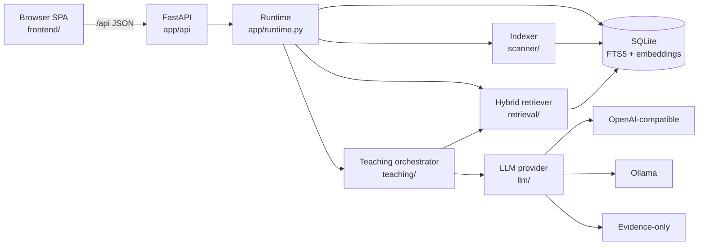

# Architecture

## Request path for a question

1. `POST /api/learn` (`api/learn.py`) validates the mode: `explain`, `flow`, `feature`, `compare`, `chat`, `troubleshoot`.
2. `teaching/orchestrator.py` resolves follow-ups (re-pinning the code cited in the previous answer), scopes the search
   to a selected feature, and asks `retrieval/retriever.py` for hits.
3. The retriever fuses keyword (SQLite FTS5 BM25), embedding similarity and exact symbol matches with reciprocal-rank fusion; symbol hits carry extra weight.
4. `teaching/context.py` builds numbered excerpts (`S1`, `S2` …) within a character budget.
5. The provider from `llm/factory.py` answers using mode- and depth-specific prompts (`teaching/prompts.py`).
6. Citations are checked against the retrieved sources; unknown ones become `[unverified citation]`.
7. If there is no provider — or the call fails or times out — `teaching/evidence.py` renders an evidence-only report
   and the response is marked `provider.mock = true`.
8. The exchange is stored as a session; cacheable explanations are saved to the knowledge base and flagged **stale**
   when the repository's `index_rev` moves on.

## Components

| Area | Module | Responsibility |
|------|--------|----------------|
| Indexing | `scanner/` | Walk the repo (skipping VCS, vendored and build directories, binaries and oversized files), parse symbols, chunk files, resolve imports, embed chunks. Incremental: only new or changed files are re-read. |
| Retrieval | `retrieval/` | Hybrid search, symbol lookup, scoped search. `embeddings.py` has an offline hashing embedder as fallback. |
| Analysis | `analysis/` | Detects components/features and builds the architecture map (Mermaid). |
| Teaching | `teaching/` | Orchestrator, prompts, quiz generation/grading, session preparation, troubleshooting signal extraction, narrative. |
| Knowledge | `knowledge/store.py` | Sessions, explanations, bookmarks, quiz results, cache keys. |
| LLM | `llm/` | `LLMProvider` interface plus OpenAI-compatible and Ollama implementations. |
| API | `api/` | Thin routers; `deps.py` holds request models. `main.py` adds the security middleware. |
| UI | `frontend/js` | `main.js` router; one module per view in `views/`; shared widgets in `components/`. |

## Extending

- **New LLM provider:** subclass `LLMProvider` in `app/llm/base.py`, then register it in `llm/factory.py` and add it to
  the `llm_provider` literal in `api/deps.py`.
- **New learning mode:** add the mode to `LearnRequest`, a prompt in `teaching/prompts.py`, retrieval handling in
  `teaching/orchestrator.py`, and an evidence renderer in `teaching/evidence.py`; then add a view that calls
  `mountChat` from `frontend/js/components/chatview.js`.
- **New language parser:** add it to `scanner/parsers.py`; symbols and chunks flow through automatically.
- **New view:** create `frontend/js/views/<id>.js` exporting `mount(root)` (optionally returning a cleanup function)
  and add the route to `ROUTES` in `frontend/js/main.js`.

## Data and privacy

Everything lives in one SQLite file under `DATA_DIR`. Source text leaves the machine only if you configure a remote
LLM or embedding provider; with Ollama and the built-in hashing embedder the tutor is fully offline.
